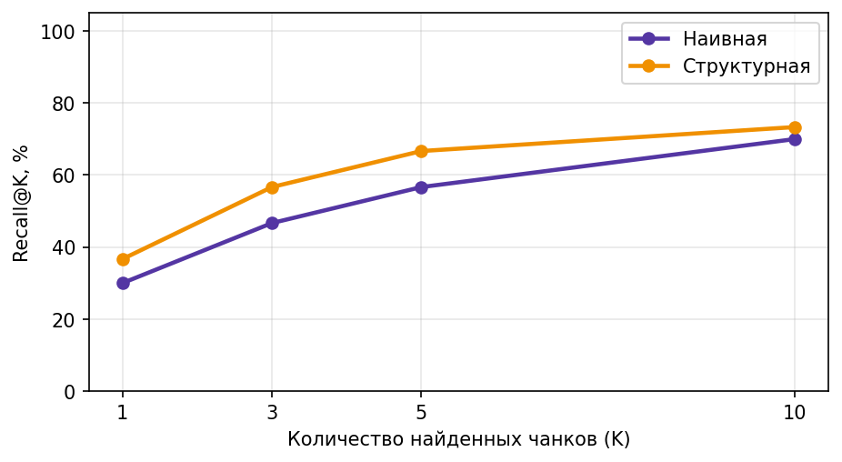
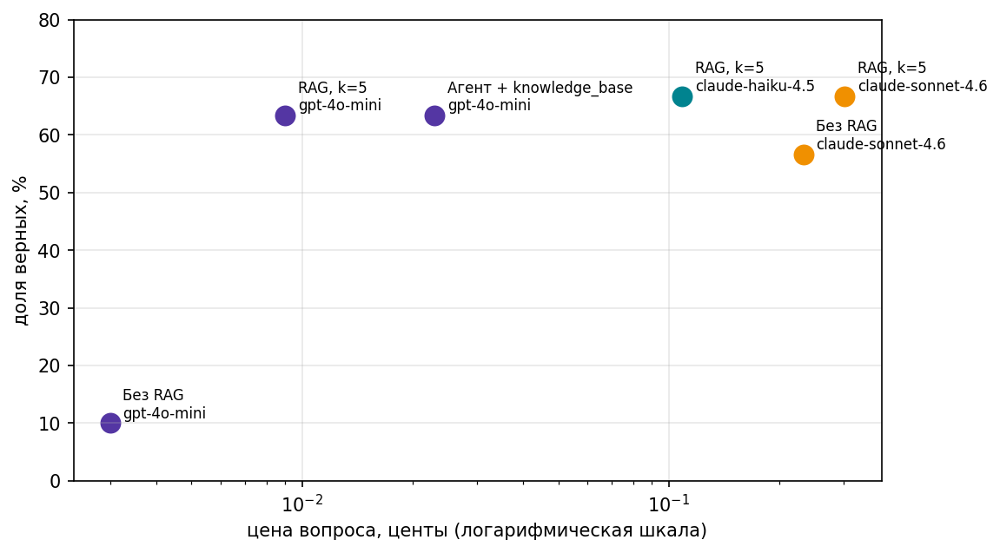
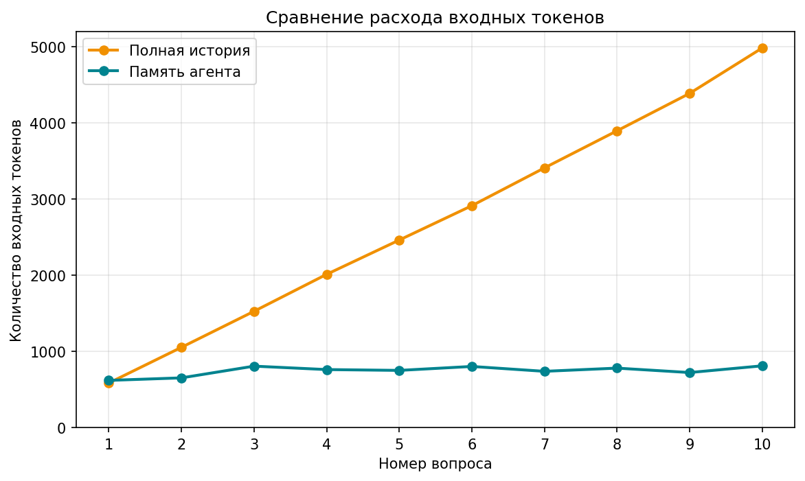
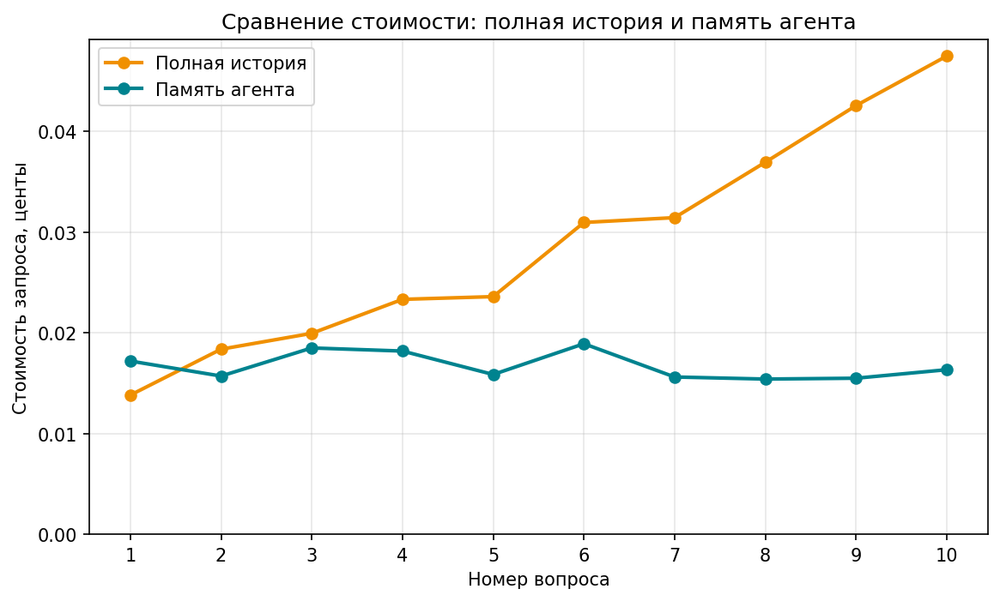

# Домашнее задание 2 - RAG и память агента

В этой работе я собрала базу знаний по рекомендательным системам, сравнила несколько способов поиска по документам и проверила, как RAG влияет на качество и стоимость ответов. Отдельно реализовала агента с инструментом `knowledge_base` и память, которая сохраняет факты о пользователе между сессиями.

Основной код и результаты экспериментов находятся в `homework02.ipynb`.

## 1. Корпус и вопросы

Корпус состоит из **8 англоязычных PDF-документов** о рекомендательных системах, в том числе о рекомендациях YouTube. Всего обработано **142 страницы** (около 624 тыс. символов текста).

Источники:

| Файл | Источник |
|---|---|
| `1707.07435v7.pdf` | [arXiv, 1707.07435](https://arxiv.org/pdf/1707.07435) |
| `1812.02353v3.pdf` | [arXiv, 1812.02353](https://arxiv.org/pdf/1812.02353) |
| `2302.09178v2.pdf` | [arXiv, 2302.09178](https://arxiv.org/pdf/2302.09178) |
| `5716.pdf` | [Google Research](https://storage.googleapis.com/gweb-research2023-media/pubtools/5716.pdf) |
| `45530.pdf` | [Google Research: Deep Neural Networks for YouTube Recommendations](https://research.google.com/pubs/archive/45530.pdf) |
| `A_Survey_of_Neural_Recommender_Systems.pdf` | [A Survey of Neural Recommender Systems](https://le-wu.com/files/Publications/JOURNAL/A_Survey_of_Neural_Recommender_Systems.pdf) |
| `youtube-multitask.pdf` | [YouTube recommendation paper](https://daiwk.github.io/assets/youtube-multitask.pdf) |
| `youtube_mozilla_2021.pdf` | [Mozilla: YouTube Regrets Report](https://assets.mofoprod.net/network/documents/Mozilla_YouTube_Regrets_Report.pdf) |

PDF лежат в `data/pdf/`. Для проверки подготовлены **30 вопросов с известными ответами** (`data/questions.jsonl`) и **10 вопросов без ответа в корпусе** (`data/unanswerable.jsonl`). У вопросов с ответами указаны `answer`, `evidence`, PDF, номер страницы и ссылка на источник.

## 2. Нарезка документов и поиск

Я сравнила два способа нарезки:

- **Наивная:** текст делится на фрагменты по 400 символов без учёта границ предложений. Получилось **1608 чанков**.
- **Структурная:** сначала выделяются предложения, затем они объединяются в фрагменты примерно до 400 символов. Так предложения по возможности не обрываются посередине. Получилось **1940 чанков**.

Каждый чанк сохраняет название PDF, номер страницы, раздел и URL исходного документа. Для эмбеддингов использована модель `text-embedding-3-small` с размерностью 512. Эмбеддинги кэшируются на диске, чтобы не оплачивать повторное создание векторов для уже обработанных текстов.

### Recall@K

| Метрика | Наивная нарезка | Структурная нарезка |
|---|---:|---:|
| Recall@1 | 30,0% | 36,7% |
| Recall@3 | 46,7% | 56,7% |
| Recall@5 | 56,7% | 66,7% |
| Recall@10 | 70,0% | 73,3% |



Структурная нарезка оказалась лучше при всех значениях `K`. Для RAG я выбрала **K = 5**: при переходе от 5 к 10 фрагментам Recall увеличивается только на 6,6 процентного пункта, при этом в запрос модели передаётся вдвое больше фрагментов.

### Поиск по словам и гибрид RRF

Дополнительно реализован поиск по словам с весами IDF и объединение результатов векторного и словарного поиска с помощью Reciprocal Rank Fusion (RRF).

| Нарезка | Поиск | Recall@1 | Recall@5 |
|---|---|---:|---:|
| Наивная | Векторный | 30,0% | 56,7% |
| Наивная | По словам | 36,7% | 73,3% |
| Наивная | Гибрид RRF | 46,7% | 73,3% |
| Структурная | Векторный | 36,7% | 66,7% |
| Структурная | По словам | **50,0%** | **80,0%** |
| Структурная | Гибрид RRF | 36,7% | 73,3% |

В этих экспериментах поиск по словам на структурных чанках дал наибольший Recall@5. Гибридный поиск оказался лучше чистого векторного, но хуже словарного. Возможно, это связано с тем, что в научных текстах часто важны точные названия методов и терминов.

Для хранения и поиска эмбеддингов использован **Milvus**. Созданы коллекции `char_chunks`, `structured_chunks` и отдельная коллекция `facts` для памяти. В ноутбуке есть пример фильтрации поиска по конкретному PDF.

## 3. Сравнение моделей и агента

Все конфигурации проверены на одинаковых **30 вопросах**. Для собственного PDF-корпуса не было эксперимента с живым веб-поиском, поэтому вместо него использована дешёвая модель без инструментов.

| Конфигурация | Модель | Верных ответов | Цена вопроса, $ | Цена верного ответа, $ |
|---|---|---:|---:|---:|
| Без RAG | GPT-4o mini | 10,0% | 0,00003 | 0,00028 |
| Без RAG | Claude Sonnet 4.6 | 56,7% | 0,00233 | 0,00412 |
| RAG, K=5 | GPT-4o mini | 63,3% | 0,00009 | **0,00015** |
| RAG, K=5 | Claude Haiku 4.5 | **66,7%** | 0,00109 | 0,00163 |
| RAG, K=5 | Claude Sonnet 4.6 | **66,7%** | 0,00302 | 0,00453 |
| Агент + `knowledge_base` | GPT-4o mini | 63,3% | 0,00023 | 0,00036 |



Haiku и Sonnet с RAG показали максимальную автоматическую точность, но Haiku обошлась дешевле Sonnet. **По стоимости одного засчитанного правильного ответа выгоднее всего оказалась GPT-4o mini с RAG.**

Для агента зарегистрирован инструмент `knowledge_base` с описанием и схемой аргументов. В ноутбуке он проверяется на обычном запросе, запросе с фильтром по PDF и запросе к отсутствующему документу. Затем агент сам решает, вызывать инструмент или отвечать без него.

Агент ответил правильно на 19 из 30 вопросов и сделал **39 вызовов `knowledge_base`**. Автоматическая точность совпала с обычным RAG на GPT-4o mini, но стоимость оказалась выше. В этом эксперименте самостоятельный выбор момента поиска не дал преимущества по цене.

### Проверка отказов

Для сравнения использованы 10 вопросов, ответы на которые отсутствуют в документах, и 30 обычных вопросов, на которые система должна отвечать.

| Система | Корректных отказов (из 10) | Ложных отказов (из 30) |
|---|---:|---:|
| RAG всегда, GPT-4o mini | **10** | 4 |
| Агент + `knowledge_base`, GPT-4o mini | **10** | **1** |

Обе системы отказались от всех десяти вопросов без ответа. При этом агент реже отказывался от вопросов с известными ответами. Сравнение всех шести конфигураций находится в `data/false_refusals.csv`.

### Разбор ошибок

**1. Ошибка поиска, вопрос `q004`.** Правильный ответ - *A/B testing*, но при `K=5` нужный фрагмент не попал в выдачу, и модель вернула `NOT_FOUND`. При `K=10` фрагмент тоже не находился, а при `K=20` появился. Здесь возможное решение - улучшить запрос или поиск, либо увеличить число возвращаемых фрагментов. Последнее повысит расход токенов.

**2. Ошибка автоматической проверки, вопрос `q020`.** Для Claude Haiku 4.5 эталонный ответ - *Hybrid model*, а модель описала гибридную рекомендательную систему другими словами. Проверка `is_correct()` не засчитала ответ, хотя его начало соответствует смыслу эталона. Для таких случаев полезно дополнить буквальное сопоставление ответов смысловой оценкой.

Значения точности в таблице получены автоматической проверкой и могут быть немного занижены: некоторые правильные переформулировки не засчитываются. Полный разбор есть в ноутбуке.

## 4. Память агента

Реализованы два вида памяти:

- **Эпизодическая:** реплики сохраняются в `episodes.jsonl` вместе с идентификатором сессии и временем. Этот журнал не передаётся в контекст целиком.
- **Семантическая:** модель выделяет устойчивые факты о пользователе, которые сохраняются в `facts.json` и отдельной коллекции Milvus `facts`. При изменении сведений старые факты заменяются новыми.

В первой сессии пользователь сообщает имя, город, интересы и предпочтение кратких ответов. Во второй сессии история начинается пустой, но агент вспоминает сохранённые сведения. Затем пользователь меняет город с Москвы на Казань и просит подробные ответы. Обновление проверено как в JSON-файле, так и в Milvus.

Без обращения к языковой модели выполнены три теста: пустая память, поиск сохранённого факта и замена устаревшего факта. Дополнительно проверена запись двух сессий в журнал.

### Сравнение расхода токенов и стоимости

Я отправила одинаковую последовательность из **10 вопросов** в двух режимах: с полной историей и с коротким окном диалога плюс факты из памяти.

| Показатель за 10 вопросов | Полная история | Память агента |
|---|---:|---:|
| Входные токены | 27 219 | 7 440 |
| Все токены (вход + выход) | 27 910 | 8 349 |
| Стоимость, $ | 0,002885 | 0,001672 |

Экономия **входных токенов составила 72,7%**, а **стоимости - 42,0%**.





При передаче полной истории входной контекст постепенно увеличивается, поэтому следующие вопросы становятся дороже. При использовании памяти размер контекста остаётся сравнительно стабильным. Полный расход токенов также показан на графике `img/memory_tokens.png`.

## 5. Итоговый вывод

Для этого корпуса RAG заметно улучшил ответы дешёвой модели: точность GPT-4o mini выросла с 10,0% без документов до 63,3% с RAG. Хотя каждый запрос с поиском дороже отдельного запроса без инструментов, **стоимость одного засчитанного правильного ответа снизилась примерно с $0,00028 до $0,00015**, то есть примерно на 46%.

Сравнить результат напрямую с живым поиском из первой домашки я не могу, поскольку для своего PDF-корпуса такой поиск не проводился. Поэтому в качестве базовой конфигурации использовала модель без инструментов. На этих данных тезис о том, что релевантный контекст помогает получать правильные ответы дешевле, подтвердился.

Память агента тоже дала экономию: вместо передачи всей переписки можно использовать небольшое окно сообщений и выбранные факты. Но качество автоматической оценки ответов ещё можно улучшить, поскольку буквальная проверка не всегда распознаёт правильные переформулировки.

## 6. Запуск проекта

Нужны Python 3.10+, Docker с Docker Compose и ключ OpenRouter. Запускать команды следует из корня проекта.

1. Установить зависимости:

   ```bash
   pip install -r requirements.txt
   ```

2. Создать файл `.env` на основе `.env.example` и указать ключ:

   ```dotenv
   OPENROUTER_API_KEY=ваш_ключ
   MILVUS_URI=http://localhost:19530
   ```


3. Запустить Milvus:

   ```bash
   docker compose up -d
   ```

   Если нужен интерфейс Attu:

   ```bash
   docker compose --profile ui up -d
   ```

4. Убедиться, что восемь PDF находятся в `data/pdf/`, а вопросы - в `data/questions.jsonl` и `data/unanswerable.jsonl`.

5.  `homework02.ipynb`  выполнять ячейки по порядку. При первом запуске создаются эмбеддинги и коллекции Milvus. При следующих локальных запусках эмбеддинги читаются из кэша, а существующие коллекции используются повторно, если число объектов совпадает.


## 7. Файлы с результатами

- `homework02.ipynb` - код и выполненные эксперименты;
- `data/pdf/` - исходные PDF;
- `data/questions.jsonl`, `data/unanswerable.jsonl` - вопросы;
- `data/rag_results_full.csv`, `data/rag_report_full.csv` - результаты и итоговая таблица шести конфигураций;
- `data/agent_results.csv`, `data/agent_unanswerable.csv` - ответы агента;
- `data/false_refusals.csv`, `data/refusal_summary.csv` - анализ отказов;
- `data/memory_tokens.csv` - расход токенов по десяти вопросам;
- `img/` - сохранённые графики;
- `docker-compose.yml`, `requirements.txt`, `.env.example` - настройка окружения.

-